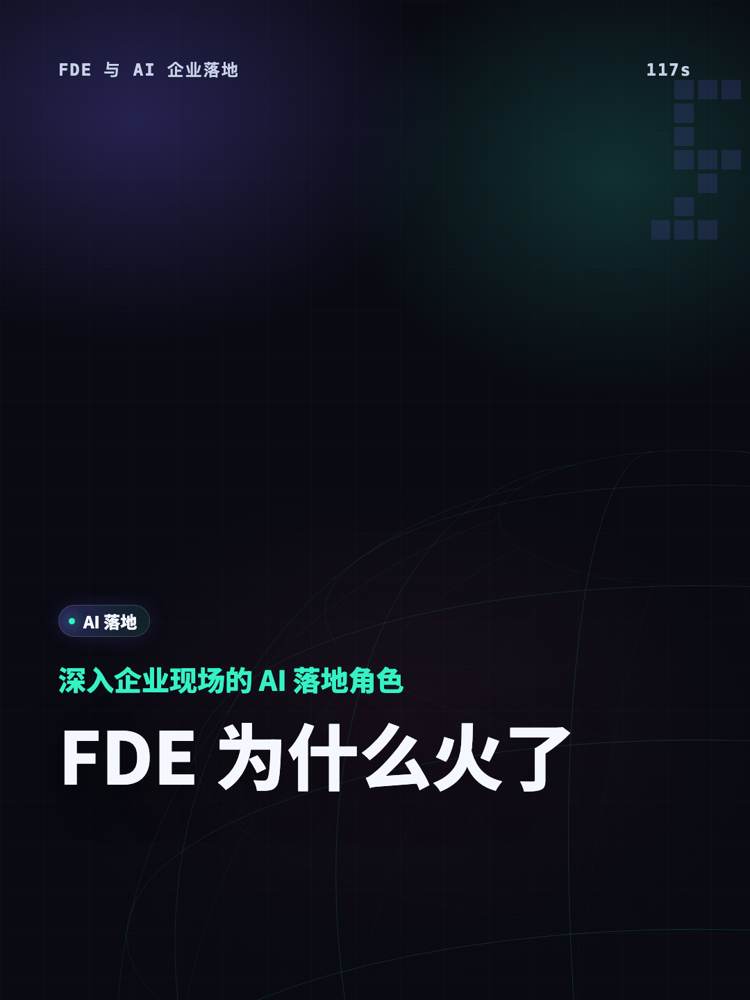
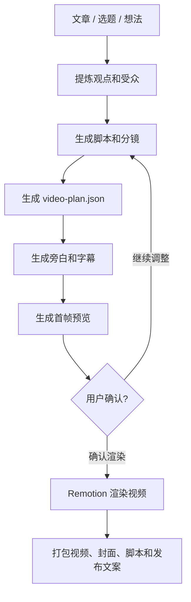

# Short Video Maker

## 默认配音与导出同步

生成旁白默认自动选择：**本地环境完整时用 VoxCPM2，否则用 Edge TTS**。用户也可显式选择 VoxCPM2、Edge 或火山引擎；三者都自动对齐字幕，共用无损混音和导出检测。运行 `node scripts/run-job.mjs <job> --render --confirmed-render` 即可，不需要额外指定配音或对齐参数。导入的旁白继续受保护，默认不重生成。详见[配置、检查和覆盖方式](references/default-voice-pipeline.md)。


中文 | [English](./README.md)

## 主线（先看这里）

默认工作流是**镜头成片**：先搜官方来源，给找到的画面素材分级，围绕真实画面逐镜头写脚本，用镜头语法渲染，测量通过且记录了画面审查之后才交给用户看。八个阶段和各自的门禁见 `SKILL.md`，脚本格式和镜头动作见 `references/shot-script.md`，质量分层见 `references/quality-bar.md`。下文的模板、导演版式、组件路线现在是**旧路线**：仍可运行、仍有测试，索引在 `references/legacy-routes.md`。

已知缺口：镜头成片的配音、对齐和打包还不是一条命令，也没有接入 `run-job.mjs`。

## 后续升级：研究、语音对齐、原生片段与多画幅

现支持官方 HTML 来源快照与素材候选发现、经明确选择的官方图片/视频下载、论点—分镜—素材来源对应、本地 Whisper 词时间匹配、原生视频区间截取及原声控制。新增 `responsive-report` 统一支持横版、竖版和 3:4 重排，并为研究型任务自动生成逐场景与安全区预览。产品解读、文章解读和日报使用不同 brief 结构。

具体入口与边界见 [研究型制作流程](references/researched-production.md)。ASR 同音字、漏读和不可靠边界会阻止自动应用；静态页面无法提取的动态演示/PDF/嵌入播放器需要合适的现有工具或显式缺口。技术检测通过不代表内容已验收，最终复核记录同时绑定当前计划和成片哈希。旧版 Auto 本地归档已按用户要求删除，历史项目与 GitHub 仓库保留。

## 第一阶段合并：本地素材入口

现已将 Auto Video Maker 的素材清单、已有旁白导入和可选音频处理迁入同一个 Short Video Maker 流程，并补齐黑场/音量/静音检测、全片抽帧预览和缺失素材清单。已有文稿/分镜与素材文件夹都使用统一 `video-plan.json`、Remotion 工程和 `run-job.mjs`。旧版先经归档验证，之后按用户要求删除本地归档，历史工程保留。

基础入口是 `scan-assets.mjs` → Agent 明确分镜/素材对应并提供时间轴 → `import-media.mjs` → `run-job.mjs`。已有旁白会禁止意外 TTS 覆盖；音频预混只播放一次。需要真实语音时间、原生片段或官网来源时，按上方升级流程接入。完整基础用法见 [本地素材流程](references/material-input-workflow.md)。

旧工程可通过 `migrate-auto-job.mjs` 显式转换到新目录；保留字幕时间和署名，记录分镜边界调整，不依赖旧 Skill。检测报告、转换及归档边界见 [交付检查](references/delivery-checks.md)。

Auto Video Maker 的独立本地入口已停用并清理；后续新任务使用 Short Video Maker，历史任务与远程仓库保留。

这个 skill 用来把一篇文章、一个主题或一个粗略想法，转成适合小红书、抖音、TikTok 风格解说视频的竖屏短视频包。

它设计为可在 Codex、Claude Code、OpenClaw 中迁移使用。Agent 负责调研、分析、脚本和分镜；本地 Node 脚本与 Remotion 工程负责校验、TTS 同步、字幕、首帧预览、渲染、封面导出和打包。

适合需要把文章、选题、课程片段或观点材料快速做成“有旁白、有字幕、有封面、有发布文案”的短视频工作流。当前以中文知识解说、观点拆解、工具方法类视频为主。

兼容 Codex、Claude Code 和 OpenClaw 的 skill 形态；本地渲染链路需要 Node.js、FFmpeg 和 Remotion。

## 预览



## 核心能力

| 能力 | 它能帮你做什么 |
|---|---|
| 短视频策划 | 从文章、主题或想法中提炼一个适合短视频的角度、受众和叙事结构 |
| 脚本与分镜 | 生成旁白、场景标题、屏幕文案、视觉方向、动效和转场计划 |
| TTS 与字幕同步 | 生成或接入旁白音频，并把字幕、场景和视频时间轴对齐 |
| Remotion 模板渲染 | 用结构化 `video-plan.json` 渲染视频、首帧预览和封面图 |
| 发布包整理 | 输出视频、封面、脚本、字幕、平台标题、正文、标签和 metadata |
| 质量检查 | 检查计划结构、时间轴、音频时长、字幕可读性和平台发布准备度 |

## 它怎么工作



Agent 负责创作判断：调研、提炼角度、写脚本、规划分镜。本地脚本负责稳定执行：校验结构、同步 TTS、生成字幕、预览首帧、渲染、质检和打包。

## 设计边界

这个 skill 借鉴了更重的视频播客工作流里的质量门、发音字典、偏好文件、平台规则和时间轴审计，但仍然保持短视频优先：

- 主线仍是 90-130 秒竖屏短视频。
- 长文章、长播客稿或 `podcast.txt` 会先抽取一个短视频角度，而不是压缩成长视频摘要。
- 完整长视频、B站/YouTube 4K 播客、批量生产和自动发布不在本 skill 主线范围内。

## 适合谁使用

当你希望 agent 从文章、主题或想法出发，完成一套短视频制作流程时使用它：

- 中文知识解说和观点视频
- 小红书、抖音竖屏视频
- 带旁白、字幕、封面和发布文案的视频
- 需要把创作判断和确定性渲染分开的 agent 工作流

不要把它当成 GitHub 发布工具。公开发布检查、安全审查和仓库同步应该交给独立的 `GitHub-skill-publisher`。

## 可以生成什么

- `analysis.json`：受众、角度、论点、风险和叙事结构
- `script.json`：旁白、场景文案和时长估算
- `storyboard.json`：场景版式、视觉方向、动效和转场
- `video-plan.json`：Remotion 使用的单一输入文件
- `voiceover.mp3` 和时间轴字幕
- `video.mp4`、`cover.png`、`script.md`、`publish.md`、`metadata.json`

## 目录结构

```text
SKILL.md                     Skill 入口
README.md                    英文说明
README.zh.md                 中文说明
assets/                      公开预览资产
references/                  工作流规则、schema 和设计指南
scripts/                     确定性工作流脚本
data/                        音色预设和复用数据
examples/                    公开示例输入
jobs/                        本地任务工作区，默认不进入 git
remotion/                    Remotion 工程
templates/                   模板包和视觉路线 token
```

音频、字幕、视频、本地任务输出和依赖目录默认不会进入 GitHub。

## 环境要求

- Node.js 和 npm
- FFmpeg 和 ffprobe
- 在 skill 根目录安装依赖
- 在 `remotion/` 目录安装 Remotion 依赖

安装依赖：

```bash
npm install
cd remotion
npm install
cd ..
npm run doctor
```

安装后，如果你的 agent 运行环境只在启动时扫描 skill，请开启一个新的 agent 会话。

Windows 首次运行路径：

```powershell
winget install OpenJS.NodeJS.LTS
winget install Gyan.FFmpeg
npm install
cd remotion
npm install
cd ..
npm run doctor
```

如果 FFmpeg 没有安装在 `PATH` 中，可以先设置 `FFMPEG_BIN` 和 `FFPROBE_BIN` 指向实际可执行文件。

## 安装方式

把这个仓库作为一个独立 skill 文件夹安装：

```bash
git clone https://github.com/chemny/short-video-maker.git
```

把克隆后的目录放到你的 Agent 会扫描的 skills 目录里，或按你的 Agent 的安装方式导入。`SKILL.md` 必须位于 skill 根目录。

安装后，如果你的 agent 运行环境只在启动时扫描 skill，请开启一个新的 agent 会话。

示例目录：

```text
<your-skills-dir>/short-video-maker/SKILL.md
```

## TTS 供应商

当前支持：

- `voxcpm2`：本地环境完整时的默认供应商，调用已有本地模型并完成 ASR 对齐。
- `edge`：没有完整本地环境时默认使用，也可显式选择；Microsoft Edge 在线 TTS，不需要 API key。运行时默认音色是 `zh-CN-XiaoxiaoNeural`。
- `local`：macOS 系统 TTS，自动模式的最后离线兜底，按实际短句音频长度对齐；Windows 不支持。
- `volcengine`：火山引擎/字节 TTS，需要用户自己提供凭证。
- `http`：通用第三方 TTS 适配器。如果供应商需要鉴权，需要用户自己提供 endpoint 和凭证。
- `none`：跳过 TTS，用于外部音频流程。

只有需要覆盖供应商配置时，才参考 `.env.example` 配置本地环境。真实密钥应放在环境变量或私有 `.env` 中，不要提交到仓库。

常用默认值：

```bash
SHORT_VIDEO_TTS_PROVIDER=auto
EDGE_TTS_VOICE=zh-CN-XiaoxiaoNeural
EDGE_TTS_RATE=default
```

Windows 需显式选择 `edge`、`volcengine` 或 `http`。不要使用 `local`，因为它依赖 macOS 的 `say` 命令。

火山引擎凭证：

```bash
VOLCENGINE_TTS_APPID=<your-app-id>
VOLCENGINE_TTS_ACCESS_TOKEN=<your-access-token>
VOLCENGINE_TTS_VOICE_TYPE=<your-voice-type>
```

## 基本流程

创建本地 job：

```bash
node scripts/init-job.mjs examples/input.md demo-video
```

填写 `jobs/demo-video/` 下的内容文件：

```text
analysis.json
script.json
storyboard.json
video-plan.json
```

只生成音频、字幕和发布包，不渲染视频：

```bash
node scripts/run-job.mjs jobs/demo-video
```

检查 video-plan 结构和时间轴：

```bash
node scripts/validate-plan.mjs jobs/demo-video/video-plan.json
node scripts/audit-timing.mjs jobs/demo-video/video-plan.json
```

生成首帧预览，给用户确认：

```bash
node scripts/run-job.mjs jobs/demo-video --preview-frame=0
```

用户明确确认后再渲染完整视频：

```bash
node scripts/run-job.mjs jobs/demo-video --render --confirmed-render
```

`--confirmed-render` 是刻意保留的确认门，用来避免 agent 在用户确认视觉方向前自动触发长时间渲染。

## 输出文件

成功运行后，输出在：

```text
remotion/public/output/
  video.mp4
  cover.png
  first-frame.png
  script.md
  publish.md
  metadata.json
```

## 验证方式

运行脚本语法检查和 Remotion 类型检查：

```bash
npm run check
cd remotion
npm exec -- tsc --noEmit
```

常用质量检查：

```bash
node scripts/quality-check.mjs remotion/public/video-plan.json remotion/public/output
```

## 新增规则文件

- `references/platform-rules.md`：小红书/抖音标题、正文、标签和 CTA 规则。
- `references/pronunciation-rules.md`：中文多音字、英文术语、人名和品牌名的 TTS 预检规则。
- `references/preference-rules.md`：本地偏好文件的读取、优先级和禁止存储项。
- `references/long-to-short-rules.md`：长文章、长播客稿、`podcast.txt` 转短视频的适配规则。
- `data/phonemes.template.json`：发音覆盖模板。
- `data/user_prefs.template.json`：可复用偏好模板。

## 来源说明与第三方名称

模板包借鉴了 MIT 授权的 `beautiful-html-templates` 项目的设计系统思路，并将其改造成适合 Remotion 时间轴视频的模板规则。Remotion、Microsoft Edge TTS、Volcengine、小红书、抖音、TikTok、Codex、Claude Code、OpenClaw、GitHub 等产品、平台和供应商名称仅用于兼容性、来源说明或使用指导。本仓库不代表这些项目或平台的官方背书。

新会话验证 prompt：

```text
请使用 short-video-maker skill，基于 examples/input.md 生成一个 60 秒中文竖屏解说视频方案。请生成脚本、分镜、video-plan、字幕和首帧预览。在我确认之前不要渲染完整视频。
```

## 许可证

MIT


自动配音的最终兜底：VoxCPM2 合成不可用时尝试 Edge；Edge 不可用时，在 macOS 上使用 `say` 系统内置音色（中文稿优先选择已安装的中文音色，其他稿件使用系统默认）。也可用 `--tts=local` 主动选择。无需安装模型、Python 或下载系统音色；字幕依据逐条合成的真实音频长度对齐，精度为短句段落，不宣称逐字识别。显式选择供应商时失败仍报错，字幕文本/对齐问题也不会触发换音色。详情见 [默认配音流程](references/default-voice-pipeline.md)。

新增 P0 制作流程：官方网页关联搜集及缺口报告、公开播放器与 HLS 点播片段获取、逐条字幕的画面对应表，以及三画幅的浏览器排版实测。新研究型项目使用 `meta.productionVersion="p0-v1"`；渲染会拦截缺失对应关系、短素材、正文字幕遮挡和失效排版报告。详见 [P0 制作与验收](references/p0-production.md)。

完整低清预览和按镜头配音、识别缓存：见 [迭代工作流](references/iteration-workflow.md)。`--preview-video` 保留已有高清成片，确认渲染时先生成或复用预览。

Default caption/pause repair and demonstration protection: [workflow](references/default-acoustic-timing.md).


### Render engine / 渲染引擎

Remotion remains the default. Select Hyperframes with `node scripts/run-job.mjs /absolute/job --engine=hyperframes --preview-video`, or save `meta.renderEngine="hyperframes"` in the plan. Both share narration, accepted caption times and verified PCM export. The optional pinned runtime is installed with `npm ci --prefix hyperframes` only when authorized. See [render engine rules](references/render-engines.md) for scope, preview and delivery paths.


### 组件与讲解时序

新增报告可使用 20 类参数化组件，支持横屏、竖屏和 3:4。组件按素材与分镜结构选择；逐项动效绑定真实字幕句子，配音重新对齐后自动重编译。旧项目保留原路径，可用 `--components=auto` 显式启用或 `--components=off` 关闭。

组件契约与默认策略见 [semantic-components.md](references/semantic-components.md)，目录见 [registry.json](components/registry.json)。图鉴只是样例，不是运行依赖；本轮不包含工作台界面。


### 逐句编排规则

新制与重做视频先锁定口播及音色，再逐条编排真实字幕对应的画面、素材、强调与切换。新报告采用 `sentence-v1` 规则，必须提供 `baseline.json` 与 `sentence-storyboard.json`，制作审计检查覆盖、时间、素材区间和字号层级。组件自动套用已关闭，组件库仍可按分镜显式选择。横竖屏分别排版，实际手机尺寸画面与完整预览需人工验收；技术检查不等于视觉批准。详见 [逐句制作规范](references/sentence-directed-production.md)。


## 本地导演流程升级（0.3.2）

新增显式选择的 `directed-news` 竖屏新闻解读候选，将B已验证的镜头配方参数化。使用现有逐句分镜写明观众理解目标、画面补充和真实字幕锚点；统一入口解析并检查。普通模板与声明的项目Remotion入口都通过同一套检查、完整预览及PCM音轨导出。新 `reviewed-v1` 流程在未取得绑定当前预览的实际视觉/听感复核记录时，只交付评审预览，不继续高清；不伪造听审通过。

风格登记修正为5套真实配置和27条兼容回退别名；新手机字号检查计入父容器缩放。B旧列表候选接入统一布局检查。组件默认仍关闭，新模板不自动成为所有题材默认；工作台和跨画幅B模板仍未实现。详见 references/director-production.md。
